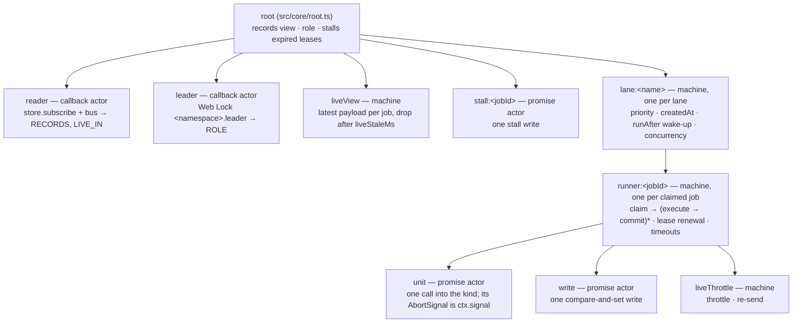
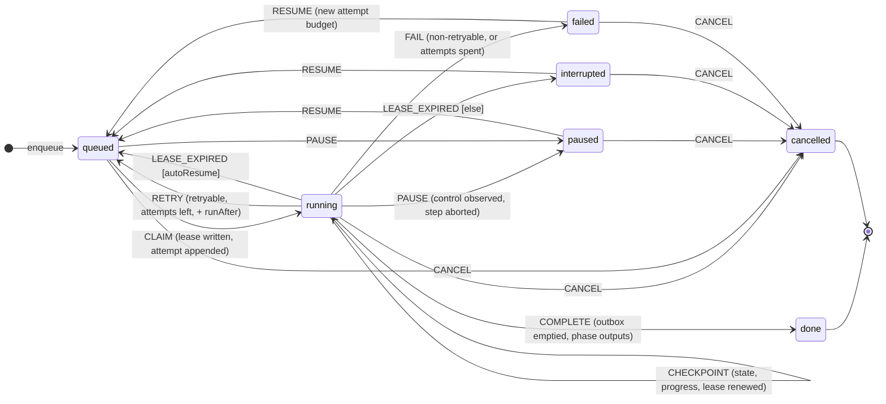
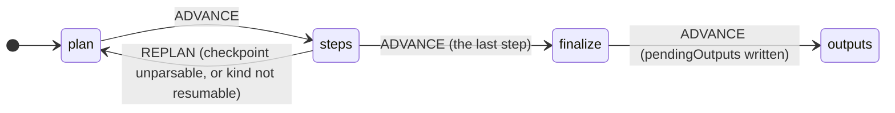

# Architecture

`@pgntools/jobs-runtime` executes long-running work in the browser durably: across reloads, crashes
and several open tabs. The public contract is the frozen v0.1 surface of CTA-216 (`src/contract.ts`);
this document is the reasoning behind it and how the implementation keeps its promises.

## Design

**Durable execution in the browser.** Every unit of work (a step) ends in one IndexedDB write of
the kind's state: the checkpoint, like Kafka's committed offset. Execution is at-least-once: a crash
replays at most the step in flight, so a kind's step must be safe to re-run from the state it was
given.

**The store is the only channel.** Pause, cancel, resume and delete are writes: a control request
on the record, or a status change. The worker in whichever tab holds the leader lock observes them
through the store subscription and the bus, and aborts the step through its `AbortSignal`. A screen
never calls into the worker.

**One leader per namespace.** A Web Lock named `<namespace>.leader` decides it. The leader
schedules every lane; any other tab only reads and writes commands. On taking leadership — and
whenever a lease runs out later — every running job whose lease has expired is *stalled*: it becomes
`interrupted`, or `queued` when its kind auto-resumes. With no Web Locks (jsdom, old browsers), a
lease-only mode serves: every tab schedules, and a tab claims only a job whose lease has expired.

**Leases.** Claiming writes `lease { owner, expiresAt }` (default 30 s), renewed at a third of that
and on every checkpoint. Losing the lease aborts the step and writes nothing more.

**Optimistic concurrency.** Every record write is a read-modify-write in one IndexedDB transaction
with a revision compare-and-set, so two tabs can never interleave a lost update. A conflict re-runs
the edit on the fresh record.

**Lanes.** Named queues with their own concurrency. Within a lane: higher priority first, then the
oldest `createdAt`, and `runAfter` respected. Scheduling is event-driven (store changes, bus
messages and XState delayed events), never a polling loop.

**Retries.** Errors are classified by the kind into `JobError { code, retryable }`. A retryable
error with attempts left schedules a re-queue with exponential backoff and jitter; otherwise the job
fails with its checkpoint kept. Every attempt is recorded. Resume after a failure starts a new
attempt budget.

**Timeouts and heartbeats.** `timeouts.stepMs` bounds a step. `timeouts.heartbeatMs` fails a step
that neither finishes nor calls `ctx.heartbeat()` within it. Both raise a retryable `timeout` unless
the kind classifies otherwise.

**Phases and the outbox.** The phases are plan → steps → finalize → outputs. `finalize` returns
`OutputPlan`s, written into `pendingOutputs` together with the phase change. Each plan is then
applied by `applyOutput` (idempotent by key) and moved to `outputs` in its own write; the write that
empties the outbox also completes the job. A resume re-enters at the recorded phase.

**Artifacts.** File outputs are written as parts, keyed `(jobId, key, seq)`, during steps or in
finalize, then sealed into one Blob. Parts and artifacts live in the store's own object stores, are
deleted with their job, and are pruned with it by retention.

**Live telemetry.** `ctx.live(payload)` is throttled (default 250 ms, the interval's last payload),
published on the bus, re-sent every second while the job runs, dropped by readers after 4 s without
news, cleared when the job's run ends, and never stored.

**History.** `JobRecord.history` holds the last 100 events: enqueued, claimed, planned,
checkpointed (every 10th step), finalized, output-applied, retry-scheduled, pause-requested, paused,
resumed, cancelled, requeued / interrupted, lease-released, failed, done.

**Versioning and leniency.** Every record read goes through a normaliser: an unknown status reads
as `interrupted`, missing fields take defaults, and a record of an unregistered kind is kept but
never claimed (`kindOf(id)` is undefined; it can only be deleted). `kindVersion` with
`parseState(value, fromVersion)` migrates a checkpoint; `undefined` means re-plan.

**Retention.** At most `retention.maxJobs` records. The oldest finished records are pruned with
their artifacts; an enqueue is refused with `too-many` when every record is unfinished.

**No side effect at import.** The package is SSR-safe: nothing touches IndexedDB,
`navigator.locks`, `BroadcastChannel` or timers until `start()` or a call. Creating a runtime and its
adapters touches nothing either.

## The runtime as XState actors

The runtime does not hand-roll its own state machines or actor plumbing: it is a tree of XState v5
actors under one root actor, created by `start()` and stopped by `stop()`. All of them run on the
runtime clock — `createActor(root, { clock })` is backed by `options.clock` — so every delay
(lease renewal, backoff wake-ups, step and heartbeat timeouts, live throttling and staleness, lease
expiry) is an XState delayed transition or delayed event, and `manualClock()` drives them all
deterministically in tests. No actor is created before `start()`.

- **reader** re-reads the records on every store change (this tab or another) and on every
  `changed` nudge on the bus, one read at a time (coalesced), and sends them to the root as
  `RECORDS`. Live messages from other tabs arrive here too.
- **leader** acquires the Web Lock and reports the tab's role: `leader`, `follower` (waiting for the
  lock), or `lease-only` (no lock configured, or acquiring rejected because Web Locks are missing).
  A lost lock makes the tab a follower again, queued for the lock.
- **root** holds the records view (`snapshot()`), forwards it to the lanes with whether this tab may
  schedule, and — while it may — spawns a **stall** write for every running job whose lease expired
  and that no runner of this tab holds, with a delayed `WAKE` at the next lease expiry.
- **lane** claims the next eligible jobs up to its concurrency, spawning one **runner** each; jobs
  running in other tabs under a live lease count against the concurrency, so a lane keeps its limit
  across a handover and in lease-only mode. It wakes itself with a delayed event at the earliest
  future `runAfter`. When the tab stops scheduling, it tells its runners to hand their leases back.
- **runner** claims its job (a compare-and-set write), then loops: invoke a **unit** (plan, one
  step, finalize, or one output), then **commit** its result in one write. Alongside, a parallel
  region renews the lease every `leaseMs / 3`, and while a unit runs, delayed transitions bound it by
  `stepMs` and `heartbeatMs` (a `HEARTBEAT` re-enters the heartbeat state, restarting its timer).
  Leaving the executing state stops the unit actor, which aborts `ctx.signal` — that is how a pause,
  cancel, delete, lost lease, timeout or `stop()` reaches the kind's step. A newer record showing a
  control request moves the runner to honour it; one showing the job gone or the lease lost ends the
  runner without another write.
- **liveThrottle** (one per runner) and **liveView** (one per runtime) implement live telemetry.

**The store stays the only durable truth.** Actor snapshots are never persisted: on `start()` and on
taking leadership the actors are rebuilt from the `JobRecord`s; commands from any tab arrive as store
writes (and `changed` nudges on the bus) and reach the actors as events. Every durable change is one
revision compare-and-set write through `writeRecord` (`src/core/store.ts`) with a pure transform from
`src/core/records.ts`.

**XState stays internal.** No XState type or actor appears in the public surface;
`test/contract.test.ts` pins it.

## The job state machine

The job lifecycle is one XState machine (`src/core/jobMachine.ts`) — the pure transition table. It
is never run as a live actor per job, because the record is the durable truth: every write resolves
the record's `(status, phase)` into a snapshot and asks XState's pure `transition` for the next one;
a refused event writes nothing. `test/jobMachine.test.ts` walks every (status, phase, event) triple
and asserts each allowed transition and the refusal of every other.

The `phase` region runs in parallel and only moves while the job is running:

Delete is allowed in every status (a running job's step is aborted first) and is not a transition:
the record is removed with its parts and artifacts.

## Guarantees

- **At-least-once steps, exactly-once state.** A step's effect is counted in the state only through
  its checkpoint write; a crash replays at most the step in flight from the last checkpoint.
- **Outputs applied once.** Plans are decided before any is applied (the outbox), each applied plan
  leaves the outbox in its own write, and `applyOutput` is called again only for a plan still in the
  outbox — so with an `applyOutput` idempotent by `plan.key`, every output takes effect exactly once.
  The applied output always carries its plan's key.
- **Resumable artifacts.** Parts are idempotent by `(jobId, key, seq)`; sealing is idempotent by key
  (a re-seal after a crash returns the sealed artifact). A restarted job's artifact is
  byte-identical to an uncrashed run's.
- **No lost updates.** Every durable change is a compare-and-set on `revision`; a conflict re-runs
  the edit on the fresh record.
- **One runner per job.** A claim is a compare-and-set that requires `queued`, a due `runAfter`, no
  pending control and no live lease; every later write of the runner requires its own lease.
- **Commands honoured within one step.** A pause or cancel written by any tab aborts the running
  step as soon as the leader sees it, and a step that finishes concurrently writes its checkpoint
  and honours the request in the same write.
- **Handover.** When the leader's tab dies, its lock passes to another tab, which stalls the
  leader's jobs once their leases expire (immediately for leases handed back by `stop()`).
- **Deterministic tests.** With `manualClock()`, every timer of the runtime waits for `advance()`.

The crash-safety suite (`test/crash.test.ts`) stops the runtime after the Nth store write for every
N across a multi-step job with two outputs and an artifact, over both the memory and the IndexedDB
store, and asserts all four properties above on restart.

## Non-guarantees

- **Not exactly-once execution.** Steps, `finalize` and `applyOutput` may run more than once; kinds
  must be idempotent as the contract says.
- **No wall-clock precision.** Timers are browser timers: throttled in background tabs and frozen in
  discarded ones. A frozen leader's lease expires and another tab takes over; the frozen tab's late
  writes are refused (its lease is gone).
- **Lease-only mode is per-tab concurrency in the worst case.** Without Web Locks every tab
  schedules; claims stay exclusive, and live leases from other tabs count against a lane's
  concurrency, but two tabs can claim two different jobs of a lane at the same instant.
- **Crash loops are not bounded.** An interruption (a crash, a closed tab) does not spend an attempt,
  so a step that kills its tab every time is retried on every reload when its kind auto-resumes.
- **Live telemetry is best effort.** It is never stored; a reader joining late sees it from the next
  re-send.
- **Retention is best effort across tabs.** Two tabs enqueueing at once may both prune; the cap may
  be exceeded by the number of concurrent enqueues.

## Decisions where the specification is silent

- **Priority**: a higher number runs first.
- **Attempt budget**: an attempt counts against `maxAttempts` when it ended in an error
  (`retry-scheduled` or `failed`); pauses, cancels and interruptions do not. Resuming a failed job
  sets `maxAttempts` to the attempts spent plus the kind's `retry.maxAttempts`.
- **Backoff**: `min(maxMs, initialMs × factor^(n−1))` for the n-th failure; jitter picks uniformly in
  the upper half, `[d/2, d]`.
- **Finished** (retention, `removeUnfinishedOf`): `done`, `cancelled` and `failed`.
- **Non-resumable kinds** re-plan whenever a run re-enters the steps phase (a resume, a retry, a
  stall); a run in finalize or outputs carries on.
- **Re-entry failures**: an input `parseInput` now refuses fails the job (`invalid-input`); a
  checkpoint `parseState` refuses in the finalize phase fails it (`invalid-state`): finalize needs
  the complete state, and re-planning there would silently redo every step.
- **Timeouts and classification**: a timeout reaches `classifyError` as an `Error` named
  `TimeoutError`; without a classifier it is `{ code: "timeout", retryable: true }`.
- **`JobStore.update`**: the edit returns the successor with `revision` one above the stored
  record's (the compare-and-set) or `undefined` to write nothing; a conflict is an `Error` with
  `code: "conflict"`; `add` of an existing id is a conflict too. `jobStoreConformance()` checks all of
  it.
- **`stop()`** aborts the steps, releases the lock and hands this tab's leases back (the jobs stay
  `running` without a lease, so the next leader stalls them at once), and clears the live telemetry it
  published.
- **`kindOf(id)`** takes a job id.
- **Live clearing** happens when the job's run on the leader ends, not between steps, so a reader
  sees no flicker between consecutive steps.
- **`runUntilIdle(runtime)`** resolves once no started runtime in the realm has a store call in
  flight for a few macrotasks; timers stay pending. Kind code waiting on the clock does not count as
  busy.

## Dependencies

The runtime takes a runtime dependency only when it is (1) really needed — it replaces non-trivial
code we would otherwise write and maintain — and (2) mature and widely used and tested in production.
Each stays ESM- and SSR-compatible and must not break "no side effect at import".

| dependency | kind | why it is needed | why it is trusted |
| -- | -- | -- | -- |
| [`xstate`](https://github.com/statelyai/xstate) ^5 | runtime | Models the whole runtime: the job lifecycle table, leader election, lanes, step runners, live telemetry. It replaces hand-rolled state machines, actor lifecycles (spawn, stop, parent/child events), cancellable delayed events and an injectable scheduler clock — the parts of a job runtime that are hardest to get right. | The reference statechart library for JavaScript, actively maintained by Stately; millions of weekly npm downloads, used in production at scale, extensively tested; ESM, no side effects at import, no browser globals touched until an actor starts. |
| `react` ^18 \|\| ^19 | optional peer | The `/react` subpath's hooks (`useSyncExternalStore`). Not imported by any other entry point. | The app's UI library. |

Development dependencies (Vitest, fake-indexeddb, jsdom, Testing Library, ESLint, TypeScript) are
not limited by this rule.
